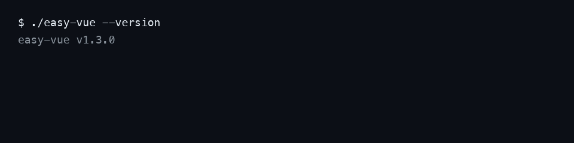

# easy-vue

<sub>[中文](README.md) · English</sub>

<p>
  <a href="https://github.com/easy30/easy-vue/releases/latest"></a>
  
  
  <a href="LICENSE"></a>
  <a href="https://github.com/easy30/easy-vue/discussions"></a>
</p>

**A Node-free Vue 3 SFC compiler in a single native binary.** It compiles `.vue` / `.ts` / `@api` sources into browser-ready ESM JS — no `node_modules`, no bundler, no build step. Any backend (Java, Python, Go, …) can drive it over HTTP or stdin/stdout.

| The usual pain | What easy-vue does |
|---|---|
| Air-gapped / offline machines where Node and npm packages can't be installed | One executable, zero runtime dependencies, prebuilt for 6 platforms |
| You only need a few Vue pages inside an existing backend | Compile `.vue` on request while the app runs (~4 ms median on a warm `serve`, measured locally); refresh to see changes |
| Docker images and installers are too big | The frontend stays source-only: no `node_modules`, no `dist` |
| A Java project that wants to write `.vue` directly | Use [easy-vue4j](https://github.com/easy30/easy-vue4j) — run `.vue` inside Spring Boot |



---

## 30-second start

```bash
curl -LO https://github.com/easy30/easy-vue/releases/latest/download/easy-vue-linux.zip   # or -mac-arm64 / -mac-intel / -win-x64 / …
unzip easy-vue-linux.zip && chmod +x easy-vue
./easy-vue serve 127.0.0.1:9000
```

Then, in another shell — no Node, no `npm install`, the compilation happens inside the binary:

```bash
curl -s -XPOST 127.0.0.1:9000/compile \
  -d '{"type":"vue","source":"<template><div>{{n}}</div></template><script setup>const n=1</script>","filename":"a.vue"}'
# → {"id":null,"ok":true,"js":"// compiled by @vue/compiler-sfc via easy-vue\n…"}
```

## Python in a minute

No pip packages needed: spawn the compiler daemon as a child process and POST sources to it.

```python
import json, subprocess, urllib.request

proc = subprocess.Popen(["./easy-vue", "serve", "127.0.0.1:9901"])   # ① compiler daemon

def compile_vue(source: str, filename: str) -> str:
    # ② .vue source → ESM JS with styles already injected
    data = json.dumps({"type": "vue", "source": source, "filename": filename}).encode()
    with urllib.request.urlopen("http://127.0.0.1:9901/compile", data=data, timeout=10) as r:
        return json.loads(r.read().decode())["js"]
```

The browser just does `import Home from '/views/home.vue'`: your route reads the file, calls `compile_vue()` and returns the result with `Content-Type: text/javascript` (ESM needs a JS MIME type).

Runnable demo: [`demo/python-minimal/`](./demo/python-minimal/) (17-line `index.html` + 111-line `main.py`, standard library only):

```bash
cd demo/python-minimal && python3 main.py   # open http://127.0.0.1:8800/
```

## Downloads

Grab the zip for your platform from [Releases](https://github.com/easy30/easy-vue/releases/latest):

| zip | platform |
|---|---|
| `easy-vue-mac-arm64.zip` | macOS Apple Silicon |
| `easy-vue-mac-intel.zip` | macOS Intel |
| `easy-vue-linux.zip` | Linux x86_64 (static musl) |
| `easy-vue-linux-arm64.zip` | Linux arm64 |
| `easy-vue-win-x64.zip` | Windows x86_64 |
| `easy-vue-win-arm64.zip` | Windows arm64 |

Each zip contains `easy-vue` (`easy-vue.exe` on Windows) **plus `esbuild` next to it** — easy-vue finds it automatically, nothing to configure (override with `ESBUILD_BINARY_PATH` if needed). On macOS/Linux run `chmod +x easy-vue` if needed.

Prefer building from source? See [develop.md](./develop.md) (needs Node + scriptc + cmake, Zig for cross-compiling).

## Commands

| command | what it does |
|---|---|
| `serve [host:]port` | **HTTP compile daemon** (recommended: concurrent, reusable, timeout-able). Port is mandatory; binds `127.0.0.1` by default, use `0.0.0.0:port` for remote access |
| `convert` | one-shot compile: read one line of JSON from stdin, write one line of JSON to stdout, exit (may read files by `filename` — intended for a trusted local build step) |
| `--version` | print the built-in version, e.g. `easy-vue v1.3.0` |

The compiler is **stateless**: nothing is cached, caching is up to the caller.

## Compile protocol (`POST /compile`, or one JSON line for `convert`)

Request fields:

| field | type | meaning |
|---|---|---|
| `id` | number | optional request id, echoed back |
| `type` | string | `vue` / `ts` / `js`; inferred from `filename` when omitted |
| `source` | string | source text (takes precedence) |
| `filename` | string | name/path used while compiling (`__name`, sourcemap, type inference). Required with `source`; **in `serve` mode files are never read from the server disk** |
| `sourcemap` | boolean | inline sourcemap when `true` |
| `style` | string | `"inject"` (default — `<style>` is compiled into the JS and injected idempotently at runtime, no `.css` to serve) or `"separate"` (also returns `css` in the response) |

Response: `{"id":…, "ok":true, "js":"…", "css":"…"}`; on failure `{"id":null,"ok":false,"error":"…"}`.

## Integrate with your backend

- **Java** — use [easy-vue4j](https://github.com/easy30/easy-vue4j): production-grade integration (daemon + process pool + compile cache), configure the binary path with `vue4j.easy-vue.path`; it can auto-download the right binary per platform.
- **Python** — [`demo/python-minimal/`](./demo/python-minimal/) (stdlib only) and [`demo/python/`](./demo/python/) (FastAPI: mock APIs, route filtering, compile cache, SPA fallback).
- **Go** — [`demo/go-minimal/`](./demo/go-minimal/): 3 files, stdlib `net/http` only; easy-vue runs as a child process that starts and stops with your server.
- **Anything else** — implement two things: start a `serve` process, `POST /compile`. Horizontal scaling = run several `serve` ports and schedule clients yourself.

## Docs

- [README.md](README.md) — full documentation in Chinese (protocol, sourcemap details, style modes, release flow)
- [develop.md](develop.md) — building from source, cross-compilation, pitfalls
- [CONTRIBUTING.md](CONTRIBUTING.md) — how to report issues and send PRs
- [RELEASE.md](RELEASE.md) — tag-driven release pipeline (GitHub Actions + Zig cross-compilation)

MIT licensed.
