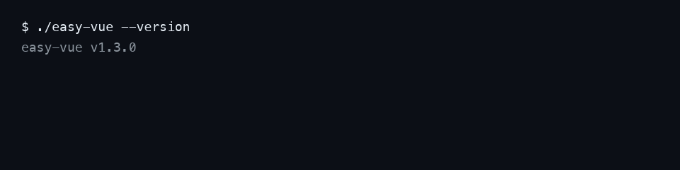

# easy-vue

<sub>中文 · [English](README.en.md)</sub>

<p>
  <a href="https://github.com/easy30/easy-vue/releases/latest"></a>
  
  
  <a href="LICENSE"></a>
  <a href="https://github.com/easy30/easy-vue/discussions"></a>
</p>

**免 Node 的 Vue 3 单文件编译器（原生二进制）**：一个可执行文件（2~5 MB，随平台），把 `.vue` / `.ts` / `@api` 编译成浏览器直接跑的 ESM JS——没有 `node_modules`、没有打包器、没有构建步骤，Java / Python / Go 等任何后端都能通过 HTTP 或 stdin/stdout 调用它。各平台免编译安装包见下方「一、获取」。

| 常见难题 | easy-vue 的做法 |
|---|---|
| 内网 / 离线环境装不了 Node 和 npm 依赖 | 解压即用的单个二进制，零运行时依赖；6 个平台免编译安装包 |
| 只想给后端塞几个 Vue 页面，不想引入整条前端构建链 | 后端读到 `.vue` 就现场编译（常驻服务里约 4 ms，本机实测中位数），改完刷新即生效 |
| 镜像 / 安装包太大 | 前端目录只剩源码：没有 `node_modules`，也没有 dist |
| Java 项目想直接写 `.vue` | 用 [easy-vue4j](https://github.com/easy30/easy-vue4j)，Spring Boot 内直接跑 `.vue` |



> 开发 / 构建 / 踩坑排查等细节见 **[develop.md](./develop.md)**；参与贡献见 **[CONTRIBUTING.md](./CONTRIBUTING.md)**。

---

## 30 秒上手

```bash
# ① 下载并解压(其他平台把文件名换成下方表格对应的 zip)
curl -LO https://github.com/easy30/easy-vue/releases/latest/download/easy-vue-mac-intel.zip
unzip easy-vue-mac-intel.zip && chmod +x easy-vue

# ② 起常驻编译服务
./easy-vue serve 127.0.0.1:9000

# ③ 另开一个终端,现场编译一个 .vue
curl -s -XPOST 127.0.0.1:9000/compile \
  -d '{"type":"vue","source":"<template><div>{{n}}</div></template><script setup>const n=1</script>","filename":"a.vue"}'
# → {"id":null,"ok":true,"js":"// compiled by @vue/compiler-sfc via easy-vue\n..."}
```

没有 Node、没有 npm install——上面的编译发生在一个原生二进制里。各平台包见下方「一、获取」；后端集成先看下一节「一分钟接入 Python」，其余语言见「六、集成到其他服务」。

---

## 一分钟接入 Python

不需要 pip 装任何包：起一个 easy-vue 常驻子进程当编译器，把 `.vue` 源码 POST 给它，拿回浏览器可直接 `import` 的 ESM JS。

```python
import json, subprocess, urllib.request

# ① 起常驻编译服务（作为你服务的子进程，随它启停）
proc = subprocess.Popen(["./easy-vue", "serve", "127.0.0.1:9901"])

def compile_vue(source: str, filename: str) -> str:
    # ② .vue 源码 → 编译 → 自带样式的 ESM JS（样式缺省注入，无需单独伺服 .css）
    data = json.dumps({"type": "vue", "source": source, "filename": filename}).encode()
    with urllib.request.urlopen("http://127.0.0.1:9901/compile", data=data, timeout=10) as r:
        return json.loads(r.read().decode())["js"]
```

浏览器侧照常 `import Home from '/views/home.vue'`：你的 Python 路由读到 `.vue` 文件后调 `compile_vue()`，以 `Content-Type: text/javascript` 返回即可（ESM 必须是 JS MIME）。

完整可运行版见 [`demo/python-minimal/`](./demo/python-minimal/)（`index.html` 17 行 + `main.py` 111 行，标准库零依赖）：

```bash
cd demo/python-minimal && python3 main.py   # 浏览器打开 http://127.0.0.1:8800/
```

---

## 一、获取

### 方式 A：GitHub Release（推荐，免编译）

从 https://github.com/easy30/easy-vue/releases 下载**对应你平台**的 zip 包：

| zip | 平台 |
|---|---|
| `easy-vue-mac-arm64.zip` | macOS Apple Silicon |
| `easy-vue-mac-intel.zip` | macOS Intel |
| `easy-vue-linux.zip` | Linux x86_64 |
| `easy-vue-linux-arm64.zip` | Linux arm64 |
| `easy-vue-win-x64.zip` | Windows x86_64 |
| `easy-vue-win-arm64.zip` | Windows arm64 |

每个 zip 内含 `easy-vue`（或 `easy-vue.exe`）可执行文件，**同一目录还有 `esbuild`**（编译 `.ts` / `@api` 用）。解压后二者保持在同一目录即可（easy-vue 会自动探测同目录 esbuild，无需配置；也可用 `ESBUILD_BINARY_PATH` 显式指定）。

> macOS/Linux 上如遇「无执行权限」，先 `chmod +x easy-vue`。

### 方式 B：自行编译

见 `develop.md`（需要 Node + scriptc + cmake，交叉平台还需 Zig）。

---

## 二、命令总览

| 命令 | 用途 |
|---|---|
| `serve [host:]port` | **HTTP 常驻编译服务**（推荐，可并发、可设超时、可多次复用）。必须显式指定端口；缺省绑定 `127.0.0.1`（仅本机），远程访问用 `0.0.0.0:port` |
| `convert` | **一次性编译**：stdin 读一行 JSON → 编译 → stdout 出一行 JSON → 退出 |
| `--version` | 打印内置版本号后退出（如 `easy-vue v1.3.0`） |

```bash
# 本机 HTTP 常驻（端口 9000）
./easy-vue serve 127.0.0.1:9000

# 远程可访问
./easy-vue serve 0.0.0.0:9000

# 一次性（stdin → stdout）
./easy-vue convert
```

**无状态**：编译不缓存（缓存策略由调用方决定）。

---

## 三、编译协议（serve / convert）

### 请求体（`POST /compile`；`convert` 则作为 stdin 的一行 JSON）

| 字段 | 类型 | 说明 |
|---|---|---|
| `id` | number | 请求 id（可选），成功时随响应回显 |
| `type` | string | `vue` / `ts` / `js`；缺省按 `filename` 扩展名推断 |
| `source` | string | 源码内容（优先） |
| `filename` | string | 文件名/路径：用作编译时的名字（`__name` / sourcemap / type 推断）。有 `source` 时必须带；**serve(HTTP) 模式只允许这种方式**，绝不按 filename 读服务器本地文件 |
| `sourcemap` | boolean | `true` 时产出内联 sourcemap（默认不产） |
| `style` | string | 样式产出方式。**缺省即 `"inject"`**：`.vue` 的 `<style>` 编译结果以幂等脚本编进 js（浏览器运行时自动插 `<style>` 标签，SSR 安全、同组件/同内容不重复插标签），响应**不含** css 字段；显式传 `"separate"` 时样式走响应的 `css` 字段（供要独立 .css 文件的调用方） |

### 响应（JSON）

| 字段 | 说明 |
|---|---|
| `id` | 回显（失败时 `null`） |
| `ok` | 是否成功 |
| `js` | 编译后 JS（尾部可带内联 sourcemap 注释） |
| `css` | `.vue` 的 `<style>` 编译结果（仅 vue 且有样式时） |
| `error` | 失败信息（`ok=false` 时） |

### 调用示例

```bash
./easy-vue serve 127.0.0.1:9000 &   # 后台常驻

# 编译一个 .ts
curl -s -XPOST 127.0.0.1:9000/compile \
  -d '{"type":"ts","source":"const n: number=1; export default n;"}'
# → {"id":null,"ok":true,"js":"const n = 1;\n..."}

# 编译一个 .vue（script setup + 样式）
curl -s -XPOST 127.0.0.1:9000/compile \
  -d '{"type":"vue","source":"<template><div>{{n}}</div></template><script setup>const n=1</script>","filename":"views/a.vue"}'
# → {"id":null,"ok":true,"js":"...","css":"..."}

# 一次性 convert
echo '{"type":"vue","source":"<template><div>{{n}}</div></template>","filename":"a.vue"}' | ./easy-vue convert
# → {"id":null,"ok":true,"js":"...","css":""}
```

### 错误示例

```bash
# convert（本地可信）允许无 source 按 filename 读文件；文件不存在时
# → {"id":null,"ok":false,"error":"file not found: /no/such.vue"}

# serve（HTTP）模式：禁止按 filename 读服务器本地文件，只接受 source
curl -s -XPOST 127.0.0.1:9000/compile -d '{"filename":"/no/such.vue"}'
# → {"id":null,"ok":false,"error":"reading server files by \"filename\" is disabled in serve mode; provide \"source\" instead"}
```

---

## 四、sourcemap

- `.ts` → 内联 sourcemap（base64 data URI）。
- `.vue` → 仅映射 `<script>` / `<script setup>` 段，`sourcesContent` 含完整 .vue 源码，浏览器 devtools 可直接读源码、断点定位。
- sourcemap 已内联进 js，调用方无需额外处理，**原样返回 js 即可**。

---

## 五、发布到 GitHub

本项目通过**打 tag 自动发版**：`.github/workflows/release.yml` 在 GitHub 托管的 macOS runner 上用 zig 交叉编译 6 个平台（mac arm64/intel、linux x86_64/arm64、win x64/arm64），再把各平台 prebuilt `esbuild` 与二进制作成**同目录 zip**，上传到 GitHub Release——解压即用，无需任何配置。

- **版本号唯一出处**是仓库根 `VERSION`（带 `v` 前缀，如 `v1.3.0`），`scripts/gen-version.sh` 把它注入二进制，`easy-vue --version` 可查
- **发版**：改 `VERSION` → 提交 → `git tag v1.3.0 && git push origin v1.3.0`；进度看 Actions 页，产物看 Releases 页
- tag 必须与 `VERSION` 一致（CI 不校验，靠发版人保证）；重建已存在的 tag 要先删远端 tag 再推
- 只发布 6 个白名单 zip、不发布裸二进制，避免中间产物（如 `serve.c`）混进 Release

详细步骤与踩坑记录见 **[RELEASE.md](./RELEASE.md)**。

---

## 六、集成到其他服务

- **Java**：如果是 Java 项目，直接参考 **[easy-vue4j](https://github.com/easy30/easy-vue4j)**（生产级集成：HTTP 常驻 + 多进程轮询 + 编译缓存，`vue4j.easy-vue.path` 配置二进制路径，缺失时自动按平台下载）。
- **Python**：两个现成 demo（都不需要写任何编译逻辑，`.vue` 由 easy-vue 现场编译）：
  - [`demo/python-minimal/`](./demo/python-minimal/) — **最简演示**（推荐先看）：仅 3 个文件，Python 标准库零依赖，`python3 main.py` 后浏览器打开 http://127.0.0.1:8800/ 即跑；
  - [`demo/python/`](./demo/python/) — **完整一体化演示**：FastAPI + Uvicorn，复刻 vue4j 的请求过滤语义（mock API / 路由排除 / 编译缓存 / SPA 兜底），`./setup.sh` + `uvicorn main:app` 即跑。
- **Go**：同样一个现成 demo：[`demo/go-minimal/`](./demo/go-minimal/) — **最简演示**：仅 3 个文件，标准库 `net/http` 零第三方依赖（连 `go.mod` 都不需要），`go run main.go` 后浏览器打开 http://127.0.0.1:8800/ 即跑；easy-vue 作为子进程随它启动、随它退出。
- **任意后端**：把「启动一个 `serve` 进程 + `POST /compile`」这套协议集成进自己服务即可；多进程水平扩展 = 多开几个 `serve` 端口 + 自己调度（客户端自选端口的具体做法见 [develop.md](./develop.md)「水平扩展」）。
